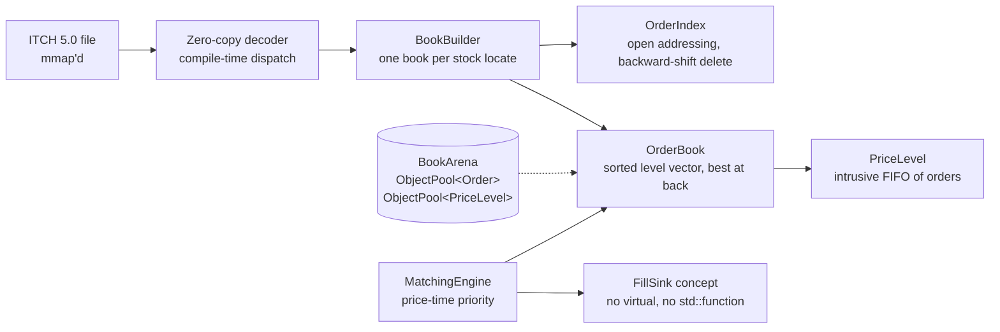

# limitbook

**Full-depth limit order book and price-time matching engine in C++20, rebuilt message by message from NASDAQ TotalView-ITCH 5.0, with a zero-allocation hot path proven by test.**

[](https://github.com/udaykishore-resu/limitbook/actions/workflows/ci.yml)


> **Repo description:** Full-depth L3 order book + matching engine in C++20. Replays NASDAQ ITCH 5.0, zero heap allocations after warmup, p99/p99.9 latency per message type, differential-tested against a std::map oracle.
>
> **Topics:** `cpp20` `order-book` `matching-engine` `nasdaq-itch` `market-data` `low-latency` `hft` `quantitative-finance` `memory-allocator` `google-benchmark` `sanitizers` `cmake`

Part 1 of a three-repo low-latency trading study:
**limitbook** (book + matching) → [feedline](../feedline) (multicast feed handler that feeds it) → [greekstream](../greekstream) (real-time options risk).

---

## Why this exists

Most order-book portfolio projects stop at "it works." This one is built to answer the questions a quant-dev interviewer actually asks:

- **Where does the hot path allocate?** It doesn't. A test replaces global `operator new`, replays 500k ITCH messages after warmup, and fails on a single allocation.
- **How do you know it's correct?** Every book is diffed level by level against a deliberately naive `std::map` oracle over a million generated messages, and the matching engine's fill stream is diffed against a naive matcher.
- **What's your tail?** Latency is reported per message type at p50 / p90 / p99 / p99.9 / p99.99 from a log-linear histogram, never as an average.

## Architecture



| Component | Decision | Instead of |
|---|---|---|
| `ObjectPool<T>` | One allocation at startup, intrusive LIFO free list | `new`/`delete` per order |
| `IntrusiveList` | Hook embedded in `Order`, O(1) unlink | `std::list` (node allocation per order) |
| `BookSide` | Contiguous vector of levels, best at back, scan from the touch | `std::map<Price, Level>` |
| `OrderIndex` | Linear probing, murmur finalizer, backward-shift deletion, never rehashes | `std::unordered_map` |
| ITCH views | Field offsets are compile-time constants; `memcpy` + `byteswap` | Parse-into-struct copies |
| Dispatch | `if constexpr (std::is_invocable_v<Handler&, const M&>)` | Virtual visitor |

Details and trade-offs: [docs/DESIGN.md](docs/DESIGN.md). Which C++ features are allowed on the hot path and which are banned: [docs/FEATURE_POLICY.md](docs/FEATURE_POLICY.md).

## Quick start (macOS / Linux)

```bash
xcode-select --install          # macOS: AppleClang
brew install cmake ninja        # or apt install cmake ninja-build g++-13

make run                        # build, generate 3M synthetic ITCH messages, replay with latency table
make test                       # 38 unit, property, differential and zero-allocation tests
make bench                      # google/benchmark suites
make asan && make tsan          # sanitizer runs
```

GoogleTest and google/benchmark are found with `find_package` or fetched over git at a pinned tag.

### Replay a real NASDAQ day

See [data/README.md](data/README.md) for where to download the free sample files. Then:

```bash
gunzip 01302019.NASDAQ_ITCH50.gz
make replay FILE=01302019.NASDAQ_ITCH50 SYMBOL=AAPL
```

## Results (first milestone)

Measured on a 2-vCPU cloud VM (Xeon @ 2.8 GHz, GCC 13, `-O3`). **These are not your numbers:** rerun `make bench` and `make run` on your own machine and replace this table.

| Benchmark | Result |
|---|---|
| ITCH decode only | 121 M msgs/s (3.5 GB/s) |
| Decode + full-depth replay, limitbook | 12.5 M msgs/s |
| Same stream, `std::map`/`std::list` oracle | 7.4 M msgs/s |
| Matching engine, passive add + cancel | 26 ns per pair |
| Replay tool, 3M msgs, no per-message timing | 9.1 M msgs/s |
| Add Order latency (incl. timer) | p50 228 ns · p99 640 ns · p99.9 1.05 µs |
| Order Executed latency (incl. timer) | p50 51 ns · p99 331 ns · p99.9 617 ns |
| Steady-state heap allocations | **0** (enforced by test) |

**The honest caveat:** the limitbook advantage over the `std::map` oracle is only 1.7x here. Synthetic books hold ~400 live orders per symbol, so the oracle's tree stays in cache. A real NASDAQ day has far more live orders and price levels. Whether the gap widens there is the first thing Milestone 2 has to measure, not assume.

**Timer resolution on Apple Silicon:** `cntvct_el0` ticks at 24 MHz (≈41.7 ns), so single-message timings on an M-series Mac are quantized. Use throughput numbers on the Mac and per-message tails on Linux x86, where `rdtsc` is sub-nanosecond.

## Testing strategy

| Test | What it proves |
|---|---|
| `OrderBook.MatchesReferenceBookUnderRandomFlow` | 300k random add/cancel/reduce ops; full depth equals the `std::map` oracle |
| `BookBuilder.MatchesSyntheticFeedReference` | 1M ITCH messages decoded end to end; every symbol's depth equals the generator's oracle |
| `MatchingEngine.MatchesNaiveOracleUnderRandomFlow` | 200k limit/IOC/cancel ops; the fill stream is identical to a naive matcher |
| `OrderIndex.MatchesUnorderedMapUnderRandomChurn` | Backward-shift deletion stays correct across wrap-around |
| `ZeroAlloc.*` | Zero heap allocations in ITCH replay and matching after warmup |
| `limitbook-replay` builds with `-fno-exceptions -fno-rtti` | The hot-path headers are exception- and RTTI-free (compile-time proof) |
| CI matrix | GCC 13 and Clang 18 × Release / ASan+UBSan on Linux, plus AppleClang on macOS |

## Project layout

```
include/limitbook/
  types.hpp  endian.hpp  object_pool.hpp  intrusive_list.hpp  order_index.hpp
  order_book.hpp  matching_engine.hpp  latency_histogram.hpp  cycle_clock.hpp
  itch/   messages.hpp  decoder.hpp  encoder.hpp  book_builder.hpp
  sim/    rng.hpp  reference_book.hpp  synthetic_feed.hpp
tools/    replay_itch.cpp  gen_synthetic.cpp
tests/    9 test files incl. zero-allocation harness
bench/    bench_book.cpp
docs/     DESIGN.md  FEATURE_POLICY.md  ROADMAP.md
```

## Roadmap: the parts left for you

Milestone 1 (this commit) gives you a correct, tested, allocation-free core. The milestones that build the skill are in [docs/ROADMAP.md](docs/ROADMAP.md):

- [ ] **M2:** Replay a full NASDAQ day; size the pools from measured peaks; publish real p99.9 numbers on Linux x86
- [ ] **M3:** Benchmark level search: linear-from-touch vs binary vs a dense price-indexed ladder; keep the winner with data
- [ ] **M4:** `perf stat` / `perf record` flamegraphs; eliminate the top two cache-miss sources
- [ ] **M5:** Validate reconstructed BBO against an independent source (vendor TAQ / NBBO file)
- [ ] **M6:** Matching engine features: self-trade prevention, iceberg orders, auction crossing
- [ ] **M7:** Consume [feedline](../feedline)'s arbitrated stream: a live multicast → book pipeline

## Skills demonstrated

- **Modern C++ (C++20):** concepts (`FillSink`, `std::derived_from`), `if constexpr` compile-time dispatch, `[[likely]]`/`[[unlikely]]`, `std::span` + `std::byte`, `std::countl_zero`/`std::bit_ceil`/`std::endian`, `std::construct_at`/`std::destroy_at`, defaulted `operator==`, feature-test macros (`__cpp_lib_byteswap`), and deliberate `-fno-exceptions -fno-rtti` hot-path builds
- **Memory and data layout:** custom object pools, intrusive containers, open-addressing hash maps, cache-line awareness (64 B on x86, 128 B on Apple Silicon), zero-allocation hot paths
- **Market microstructure:** ITCH 5.0 add/execute/cancel/delete/replace semantics, L3 book reconstruction, price-time priority, IOC/market orders, priority rules on modify
- **Performance engineering:** log-linear latency histograms, TSC/`cntvct_el0` cycle counters, google/benchmark, tail-latency reporting
- **Correctness engineering:** differential testing against oracles, property-based random testing, allocation-counting harness, ASan/UBSan, `-Werror` with `-Wconversion`
- **Build and CI:** CMake presets, FetchContent with `find_package` fallback, GitHub Actions matrix (GCC/Clang/AppleClang × sanitizers)

## License

MIT © Udaykishore Resu
